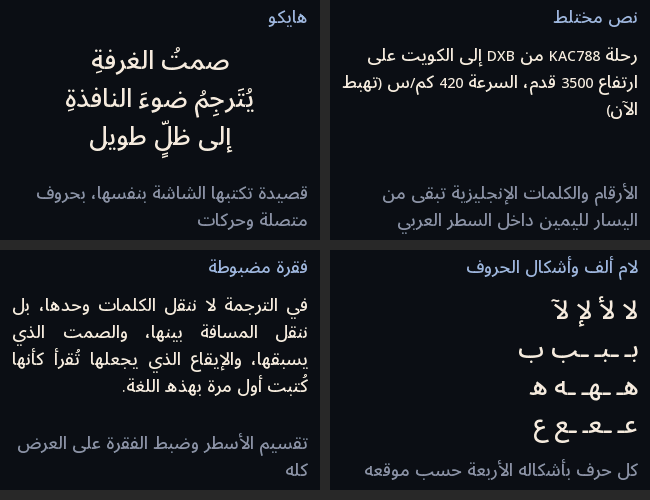

# Dal · دال

**Arabic text for small screens.** Correctly shaped Arabic on ESP32 / Arduino displays:

- connected letters in all four joining forms (isolated, initial, medial, final)
- lam-alef ligatures (لا لأ لإ لآ)
- harakat placed over / under their letter (shadda + vowel stacked)
- right-to-left layout with numbers and Latin words kept left-to-right inside it, mirrored brackets
- word wrapping, right / left / centre / justified alignment, several paragraphs (`\n`)
- anti-aliased glyphs (4-bit) generated from a real Arabic font — Noto Sans Arabic included in four sizes (14, 18, 22, 26 px)
- works with **LovyanGFX**, **TFT_eSPI**, **Adafruit GFX** or any `drawPixel()`



## Use

```cpp
#include <Dal.h>
#include <fonts/DalNoto26.h>

DalText dal(&DalNoto26);          // global: it keeps a ~14 KB working buffer

dalDraw(&tft, dal, "مرحبا بالعالم", 10, 10, 300, DAL_RIGHT, 0xFFFFFF, 0x000000);
//        screen  text                x   y  width  align      colour    background
int h = dal.measure(text, 300);     // height the text needs
```

## Your own fonts and sizes

```
pip install pillow   # with libraqm
python tools/make_font.py Arabic.ttf Latin.ttf 22 DalMyFont22 src/fonts/DalMyFont22.h Regular
```

## Status (0.1.6)

Done: shaping, lam-alef, harakat, bidi for Arabic with numbers and Latin (paired brackets, percent sign, Arabic-Indic digits), wrapping, justification by spaces.

Tested against HarfBuzz (joining forms) and FriBidi (visual order), and on the 517 cases of Unicode's BidiCharacterTest that use Arabic, Latin, digits and ASCII punctuation in a right-to-left paragraph: all pass. Hyphenated numbers (3-1, 2026-0458) are deliberately kept together left-to-right.

## Changes

- 0.1.6: Arabic section in this README (install, usage, what's new).
- 0.1.5: paired brackets follow the Unicode rule (book(s) inside Arabic), % sits on the left of a number in Arabic text (%15), Arabic-Indic digits stay Arabic numbers.
- 0.1.4: first release.

## Planned

Kashida justification, better harakat placement on tall letters, more fonts.

---

## بالعربية

مكتبة **دال** تكتب العربية صحيحة على شاشات المتحكمات الصغيرة: حروف متصلة بأشكالها الأربعة، ولام ألف، والحركات، والكتابة من اليمين إلى اليسار مع بقاء الأرقام والكلمات اللاتينية في اتجاهها، وتقسيم الأسطر والمحاذاة. الخطوط تُولَّد من خطوط عربية حقيقية بحواف ناعمة.

### التثبيت

في Arduino IDE: نافذة **Library Manager**، ثم البحث عن **Dal**، ثم **Install**. والمثال **DalDemo** في قائمة **File ← Examples ← Dal**.

### الاستعمال

```cpp
#include <Dal.h>
#include <fonts/DalNoto22.h>

DalText dal(&DalNoto22);   // متغير عام

dalDraw(&tft, dal, "مرحبًا بالعالم", 10, 10, 300, DAL_RIGHT, 0xFFFFFF, 0x000000);
```

### الجديد في 0.1.5

- الأقواس حول كلمة لاتينية داخل جملة عربية تبقى في مكانها: book(s)
- علامة النسبة تُكتب على يسار الرقم في النص العربي: %15
- الأرقام الهندية (٠١٢٣) تبقى أرقامًا عربية حتى بعد كلمة لاتينية

المؤلفة: دلال نصرالله · الرخصة: MIT
